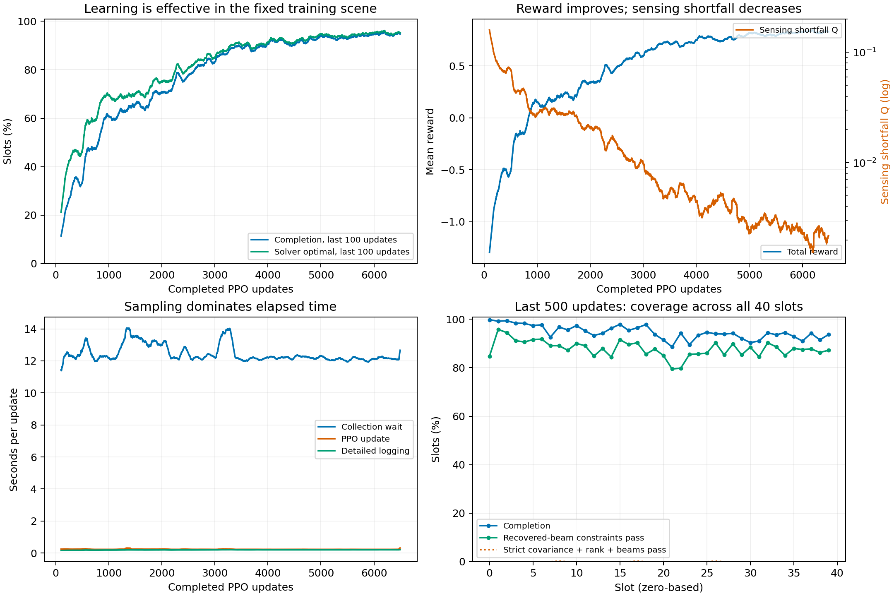

# 匹配波束同步双环境：训练效果与更新耗时分析

**结论：训练对当前程序的奖励和任务完成判据显著有效，最近仍缓慢改善；双环境确实并行。约16秒是采样加更新的一整轮墙钟，真正的PPO更新通常只有0.22–0.24秒。N1可能降低单轮延迟，但不等于提高样本吞吐或达到同一成绩的速度。另有原约束验收缺口：日志completion不能直接等同于完整物理可行率。**

冻结到北京时间 **2026-10-20 09:03:25，update 6493，519440条transition，12986个40槽episode**。分析时训练继续运行，后续数据没有混入。冻结于09:03:37。只读原训练、模型与日志；新增本目录与任务计划记录，没有训练/策略评估/solver调用，没有修改生产算法或参数、操作用户训练进程。

## 1. 配置及证据口径

- 真实命令与用户提供一致：N2、同步、seed42、scene offset0、worker PyTorch线程1、MOSEK线程1、alpha0。device=cpu；日志记录6个逻辑CPU。
- 每轮每worker一条完整40槽episode，两个worker共80个样本；同一旧actor/normalizer与固定外生场景，独立动作随机流。采集版本r−1，更新完成后版本r。
- alpha0执行匹配接收波束，80个beam坐标从活动log-prob/entropy中排除，剩22连续维及4个离散匹配头参与学习。本次高完成率不能称为“PPO学会了接收波束”，也不能归因于N2优于N1。
- 6493轮CSV/文本、12986条worker摘要逐轮对齐；权重checksum、版本链、80样本、计数、两worker及原奖励CSV一致。30个生产源码SHA均匹配运行metadata。6份checkpoint actor/critic文件SHA通过；未执行checkpoint策略评估。
- 161个TensorBoard标量tag均覆盖6493轮，所有BS网络指标有限；Obj/iteration含inf来自无解步能耗，并非网络NaN证据。
- 分阶段物理统计使用5994–6493的40000条原始env记录，每条保留源文件/字节偏移/原始行SHA。记录身份、40槽边界、版本、逐轮reward/Q/completion重算均通过。没有复制2GB原始日志，原始分片仍受用户既有滚动策略管理；本目录保存紧凑指标和验收选例。

## 2. 训练是否有效

表中completion为训练时随机抽样策略的**时隙比例**，不是整条40槽episode全部成功率，也不是测试集评估。

| 更新窗口 | completion | solver optimal | reward | 感知短缺Q↓ |
|---|---:|---:|---:|---:|
| 1–500 | 26.7550% | 39.4175% | −0.749538 | 0.091729 |
| 501–1000 | 52.8500% | 63.7975% | −0.023894 | 0.036447 |
| 2001–2500 | 74.9225% | 78.5825% | 0.430341 | 0.016859 |
| 5494–5993 | 94.0800% | 94.8300% | 0.821009 | 0.002522 |
| **5994–6493** | **94.6575%** | **95.2475%** | **0.828973** | **0.002144** |
| 6394–6493 | 94.7500% | 95.2625% | 0.829888 | 0.002175 |

首末500轮completion提高67.9025个百分点，Q下降约97.66%。最近相邻500轮completion提高0.5775个百分点，reward提高0.007964、Q降低约14.97%。长期效果清楚；近期增益较小，尚不能称已稳定100%或证明收敛。最近500轮单次80样本的completion最低58.75%、最高100%，17轮为100%；最高100轮滑动均值95.6625%发生于6199，并非每个短窗口单调变好。

最近500轮按时隙拆分：

| 时隙（0-based） | completion | 平均Q | 平均UAV–目标距离 |
|---|---:|---:|---:|
| 0–3 | 99.2000% | 0.000082 | 51.75m |
| 4–7 | 96.5000% | 0.001311 | 67.37m |
| 8–39 | 93.8594% | 0.002506 | 98.63m |

这次提升覆盖后32槽，不能沿用旧学习波束run“主要只有前8槽有效”的结论。各槽completion为88.6%–99.8%；两个worker分别94.690%/94.625%，没有一侧失效的迹象。1000条episode中167条40槽全成功，即16.7%，说明高单槽完成率仍不等于高整回合可靠性。

动作分布亦有变化：CU匹配平均pmax从首500的0.4103到末500的0.9131、逐头entropy从1.7010降到0.2239；UAV方向条件Beta std从0.23235降到0.21069。时长/功率std仍约0.2806/0.2776；宽分布本身不证明这些头没有学习。最近500 critic loss中位数1.516、均值3.274、最大188.943，signed sampled KL均值0.01943、最大0.17723：没有持续数值发散，但缺逐头clip、梯度、explained variance，不能据此保证每次更新都温和。该KL估计可能为负，不能把单次负值解释成理论KL为负。

固定42/0、三个episode随机化开关全关，只能支持当前训练场景内的学习判断；未做冻结策略、独立动作seed或新场景评估。reward与覆盖变化同时发生，不能据总体reward直接宣称同覆盖能效已经最优。

## 3. 原物理约束验收仍有缺口

当前success定义位于my_env.py：无解惩罚、碰撞惩罚、频谱冲突惩罚均为0。它没有将诊断中的恢复波束原约束检查直接纳入success。

最近40000步中：

- 原completion：37863步，**94.6575%**。
- 恢复波束原约束检查通过：35128步，**87.8200%**；再同时要求外层动作通过为34923步，**87.3075%**。
- 恢复波束失败2971步，全部涉及c08 UAV卸载约束。其中2940步仍被原success记为完成。失败步最坏UAV的卸载缺口中位52.06bit、95分位243.13bit；归一化缺口中位11.89%、95分位59.18%。不能全部归为1e−6容差边缘误差。
- covariance检查通过72.2725%，主要失败项为PSD及少量c08；其中PSD失败的严重程度本次未逐项定量，不能笼统等同于严重物理违约。
- 严格复合physical_solution_verified仅6/40000=0.015%，但它还要求covariance、恢复波束以及8个矩阵的绝对/相对rank条件同时通过。相对rank阈值1e−5与内层以绝对gap≤gamma2为主的停止条件不同，只有12个返回解通过rank诊断。**不能把0.015%直接当成“只有这些恢复波束物理可用”**；应分别报告87.82%的恢复波束检查与严格矩阵/rank诊断。

因此准确结论是“现有目标学习有效，原物理任务的最终验收尚不充分”。本次没有修改completion或solver状态，也没有实施修复。下一步宜先审计c08在凸子问题、波束恢复、奖励判据之间的一致性，再给最终约束满足率和能效结论。

## 4. 实际需要多少秒，16秒在哪里

以下墙钟来自父进程文本UPDATE时间戳；其精度为1秒，单轮差分可有约±1秒量化误差。分项来自CSV高精度自身时钟；500轮均值用于主结论。没有跨worker比较Python3.9 Windows perf_counter绝对起点，也没有据此画伪精确重叠时间线。

| 窗口 | 整轮平均 | 中位数 | 95分位 | 采样等待均值 | PPO均值 | JSONL写入均值 |
|---|---:|---:|---:|---:|---:|---:|
| 全6493轮（差分6492次） | 12.928s | 13s | 15s | 12.441s | 0.235s | 0.193s |
| 最近500轮 | **12.774s** | 13s | 14s | **12.270s** | **0.243s** | **0.203s** |
| 最近100轮 | 13.250s | 13s | **16s** | 12.665s | 0.310s | 0.210s |

最近100轮有8轮≥16秒，最大20秒；“每轮固定16秒”不符合冻结数据。最近500轮采样等待占96.05%，PPO占1.90%，JSONL写入占1.59%，余项约0.46%（聚合/校验/归一化/广播/CSV/TB/文本/checkpoint等，部分后处理可能与下一轮采样重叠）。采样等待已经包含worker采样与传输/聚合，不可再加worker采样最大值。

实际例子：

| update | worker0/1采集 | 父采样等待 | PPO | JSONL | UPDATE间隔 |
|---|---:|---:|---:|---:|---:|
| 6400 | 11.606 / 11.709s | 11.710s | 0.225s | 0.196s | 12s |
| 6476 | 15.655 / 15.504s | 15.760s | 0.333s | 0.208s | 16s |
| 6483 | 13.996 / 13.980s | 14.017s | 1.670s | 0.261s | 16s |

6476的16秒主要来自采样；6483则是较慢采样加一次PPO尖峰。6480 PPO达3.869秒、两worker采样约15秒，整轮20秒。日志没有这些时刻的历史CPU/硬缺页/磁盘/频率记录，不能唯一归因为Windows调度、内存或某后台程序。分析程序也在用户机器运行，不能将分析期间负载当成干净测速条件。

## 5. 采样的12秒具体花在哪里

从40000个env诊断的自身时长，按1000条40槽worker episode累计：

| 单个worker完成40槽的项目 | 平均 |
|---|---:|
| run_pc3p_fusion累计调用 | **11.529s** |
| sensing/candidate/原约束诊断 | 0.138s |
| 推理、环境/记录组装等剩余部分 | 0.375s |
| 该worker完整采集 | **12.041s** |

内层调用占worker采集95.74%。这里的11.529秒包括PC3P初始化、参数同步、多次model.solve、解读取、目标/rank计算和恢复，**不是纯MOSEK内点数值内核时间**。现有计时不能再把它精确拆成数值求解与Python/Fusion开销。

每时隙调用均值0.2882秒；平均3.069次CCCP迭代，中位3、95分位4、最大10。一轮N2的80步累计245.5次model.solve；两worker分别顺序执行各自40个状态依赖时隙，无法将一个worker的40槽自动拆成两路20槽。

optimal步平均3.172次CCCP、0.2925秒；infeasible步平均1次、0.2011秒。这解释为什么可行覆盖高的当前策略可能比大量早期无解的策略更贵，不能拿旧无解为主的N1速度作为本次N1应有速度。两类状态负载不同，这不是隔离变量的因果测速；3倍迭代也没有导致3倍调用时间，不能按迭代数直接推墙钟倍数。

Fusion进程内模型缓存已经存在，按(I,J,N)复用，不是每时隙重建整个Model；warm-start跨时隙并未由该缓存自动保证。采样worker持久运行，spawn导入只是初始启动开销，不能解释每轮12–16秒。

## 6. 两个env确实并行，为何单轮不减半

当前主流程：给两worker广播actor/norm与采集许可 → 两worker各采40槽 → 收齐并验证80样本 → learner串行PPO更新 → 广播下一版本。不是40槽总任务被分成两半，而是每轮总样本从40增至80。每条轨迹内部有状态依赖，仍须顺序采样。

合理近似是

\[
T_2\simeq\max(W_0,W_1)+U_{80}+L_{80}+O_2,
\qquad T_1\simeq W^{(N1)}+U_{40}+L_{40}+O_1.
\]

最近500轮worker0/1各采12.050/12.032秒，两者累计24.083 worker·秒，而父采样等待12.270秒、worker最大耗时12.265秒。这与并行等待较慢worker一致，不能解释成两路求解串行累加。同步屏障会让快者等待慢者，两个worker的耗时差平均0.447秒，约是平均worker耗时与最大耗时差的两倍；它是小成本，不能解释全部12–16秒。

主进程Queue.get循环只是收取已独立执行的结果，不是依次调用两个env.step。真实队列effective maxsize=2，虽然CLI原始sample_queue_maxsize默认1，main已提升到至少N；不能据原始配置1归因队列串行化。每轮版本许可阻止跨版本无限预采样是同步on-policy合同，并非并行失效。

10月20日09:08:40的单次资源快照见resource_snapshot.json：6物理/6逻辑CPU，两个采样进程同时活跃、约84%和99%单核CPU，learner在等待；可用RAM约1.82GiB。它只支持快照时两worker均执行，不证明整个历史负载，更不证明早前尖峰必由换页引起。没有发现另一个训练主进程；本次分析python单列。

并行仍可能使每个worker相对于独占运行稍慢：共享CPU/cache/内存带宽；NumPy/BLAS线程可能超出两项线程选项；详细对象序列化/队列与learner串行后处理；同步较慢worker屏障。**这些是机制与待测因素，当前数据未分解每项N2相对N1的增量成本。** 不能直接断言CPU已饱和、MOSEK被许可证串行、GIL阻止多进程并行。

## 7. 换N1是否更快，应如何比较

要分开三个问题：

1. **每次update延迟：N1有可能更低。** 不等第二个worker，JSONL约少一半，PPO计算量降低。但同策略仍需采40槽、约40次PC3P调用，不能期待从13秒自动变6.5秒。
2. **每条新样本的吞吐：不能用单轮更短判断。** 当前N2最近500轮80/12.774=6.2627步/秒。N1只有当40/T1>6.2627，即**T1<6.387秒**，才在该窗口胜过N2。若以16秒N2轮作比较，临界才是8秒。当前没有同alpha0、同checkpoint/norm、同动作种子和负载的N1测速，不能报告本次精确加速倍数或断言N1一定赢。
3. **学到相同质量所需墙钟：还取决于样本效率与更新频率。** batch32、epochs5且保留尾batch：N1每网10次Adam/update，N2每网15次；每样本仍复用5遍。N1每40新样本反馈策略，N2每80新样本反馈策略；相同环境样本下LR进度与normalizer更新节奏不同，不能只比较update数。PPO原文Algorithm1同样区分N条轨迹、每轨迹T步和NT样本的一次优化。

当前PPO只有约1.9%墙钟，即使完全消除也只约1.019倍端到端提速；即使只算详细JSONL写入完全消除也约1.016倍。该上界不包括进一步改采样端诊断/通信的潜在收益。内层必要条件筛查能提前免掉的当前infeasible只有约4.74%，此前在无解主导run里提出的高收益不能照搬。不要未经等价性验证放宽求解容差、少做CCCP或关闭关键诊断来换名义速度。

建议保留N2现有结果；要决定N1/N2，先离线固定同一alpha0 checkpoint、配套norm、场景和动作流，在无其他训练竞争的窗口串行执行N1→N2→N2→N1，排除冷启动，报告父墙钟、步/秒、worker耗时及CCCP次数/成功覆盖。若进一步比较学习效率，使用同初始权重、明确同样本或同墙钟预算、对齐LR按环境步的进度并记录不同更新节奏，之后再做多seed冻结策略评估。本次仅给出可执行的比较协议，没有启动测速/新训练。

## 8. 可核查源码与外部依据

- 本项目：MHBPPO_main.py:516同步聚合，699–714队列，798–810持久worker启动，871–905采样计时，931–963日志及PPO计时，1013–1029广播/下轮许可；MHBPPO_sampler.py:294–320许可，369起40槽采集，453完成计时；MHBPPO_agent.py:460–461五遍minibatch；cccp_bridge.py:321–323内层调用计时；fusion_pc3p.py:682起缓存、742起PC3P、786–788求解循环；my_env.py:686起原success；feasibility_diagnostics.py:184起原约束、253起rank与复合验证。以当前30源码SHA匹配为依据。
- Python Software Foundation，Python 3.9官方文档，*multiprocessing — Process-based parallelism*：独立子进程、Queue pickle/后台管道机制。[官方文档](https://docs.python.org/3.9/library/multiprocessing.html)。
- MOSEK ApS，MOSEK 11.1 *Fusion API for Python*, §10.5–10.6：线程参数仅约束optimizer；小问题线程开销、NumPy额外线程与Fusion参数化。[官方章节](https://docs.mosek.com/11.1/pythonfusion/guidelines-fusion.html)。
- Schulman, J., Wolski, F., Dhariwal, P., Radford, A., Klimov, O. (2017), *Proximal Policy Optimization Algorithms*, arXiv:1707.06347，Algorithm1，第5页；这是arXiv预印本，不编造期刊/会议出处。[原始PDF](https://arxiv.org/pdf/1707.06347)。该出处支持并行采样/多epoch结构，不意味着本项目连续/离散分组surrogate与原PPO完全相同。

## 9. 复现与验收

主要证据：summary.json、worker_episodes.csv、metrics_with_timestamps.csv、physical_steps.csv、physical_summary.json、physical_acceptance_summary.json及验收选例、ppo_scalars.csv、tensorboard_summary.json、policy_summary.json、source_check.json、checkpoint_file_checks.json、resource_snapshot.json、frozen/及frozen_manifest.json。脚本analyze.py、extra_analysis.py、check_physics_and_verify.py；core会重新冻结当前活动run，历史结果应直接用frozen/复算，不覆盖冻结后冒充原09:03:25边界。

core_validation、physical_validation与final_validation全部通过；独立csv.DictReader加法复算四窗口均值与optimal计数、逐步成功/物理计数、时长非负和生产SHA再次核验。PNG/SVG已生成并目视检查。历史U37/U43原始测速目录在本次可用文件中未找到，计划中历史倍率只保留原适用范围，本报告不引用其倍率证明本次N2收益。

